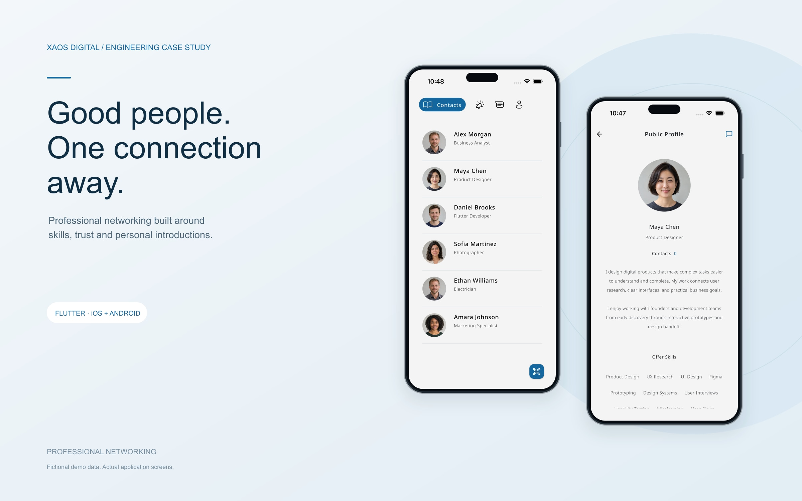

# Professional Networking — Flutter Case Study

A mobile networking application for finding specialists, services and work through skills, personal connections and mutual contacts.

[Live Demo](https://shteinyr-community-network.web.app) · [Android APK](https://github.com/Shteinyr/paul-flutter-prototype/releases/latest) · [Architecture](docs/PROJECT_SPEC.md) · [Development process](CONTRIBUTING.md)



## The problem

Professional referrals in a New York community were spread across conversations and messaging groups. Finding a specialist meant repeating the same request and manually checking who knew whom.

The product brings profiles, offered and sought skills, mutual contacts, messages and community hiring requests into one application. Organisers get a structured directory and shared requests; members can find relevant people and start a conversation with useful context. These are product goals, not measured business results.

## Implementation

- One Flutter/Dart codebase with iOS and Android hosts and browser targets.
- Profiles, photos, offered/seeking skills, ESCO suggestions and free-text entry.
- Name/skill search, All / Offer / Hiring filters and mutual contacts.
- Invitation QR/link/code, onboarding and server-enforced session admission.
- Text conversations, history, unread indicators, drafts and duplicate-send protection.
- Hiring publication, author-controlled closure and 30-day expiration.
- Managed-profile administration, roles, account deletion and durable photo cleanup.
- Supabase PostgreSQL/Auth/Storage/Realtime/Edge Functions; browser push and native Firebase integration.

The project is presented as an engineering case study. Store distribution, real mobile-provider acceptance and production operations are separate from source code and build checks.

## Try without credentials

The existing offline demo uses fictional contacts, local profile storage and simulated conversations. It demonstrates the original interactive prototype. Live Hiring, administration, real multi-user messaging and notification delivery belong to the full implementation and are not presented as working production services in this demo.

Validated toolchain: **Flutter 3.47.9 / Dart 3.13.7**. Dependencies are pinned in `pubspec.lock`.

```sh
git clone https://github.com/Shteinyr/paul-flutter-prototype.git
cd paul-flutter-prototype
flutter pub get --enforce-lockfile
flutter run -d chrome --dart-define=PAUL_TARGET=demo
```

### Android

Download the ARM64 demo APK (release mode, development signature) from [Releases](https://github.com/Shteinyr/paul-flutter-prototype/releases/latest), or build it:

```sh
flutter build apk --debug --dart-define=PAUL_TARGET=demo --target-platform android-arm64
```

Output: `build/app/outputs/flutter-apk/app-debug.apk`. This is a demonstration build, not a Play Store release. Android may ask you to allow installation from the application used to open it.

### iOS

On a Mac with Xcode and the Flutter iOS prerequisites:

```sh
flutter devices
flutter run -d <ios-simulator-id> --dart-define=PAUL_TARGET=demo
```

For a physical iPhone, open `ios/Runner.xcworkspace`, configure your own signing team and run on your trusted device. An unsigned IPA is not a universal installation link. TestFlight/App Store distribution requires the appropriate Apple developer setup. Minimum deployment target: iOS 15.

### Browser build

```sh
bash scripts/build_demo.sh
python3 -m http.server 8080 --directory dist
```

Open `http://localhost:8080`.

## Complete server-backed application

The original authentication and invitation rules are preserved. Configure your own Supabase environment and the documented migrations/functions. Copy `config.example.json` to ignored `config.local.json` and enter your own public settings.

```sh
flutter run -d <device-id> --dart-define-from-file=config.local.json
```

| Target | Purpose |
| --- | --- |
| `demo` | Existing offline prototype with fictional data |
| `app` | Installed application with server admission |
| `preview` | Limited read-only browser experience |
| `review` | Complete browser review with normal server authentication |

Selecting a target does not grant membership or administrator rights. Google/Apple, Firebase/APNs, signing and domain associations require their corresponding owner-controlled accounts. Server/provider secrets are never client settings.

## Architecture and engineering

Views, controllers and persistence are separated across `lib/profile`, `lib/onboarding`, `lib/live`, `lib/community` and `lib/admin`. Platform adapters handle contacts, sharing, links, notifications and durable SQLite journals.

Server operations enforce ownership, membership and roles independently of the interface. Stable operation identifiers protect retries. Profile merge handling protects edits from another device. Background maintenance completes expiration and deletion independently of notification availability.

## Development process

Requirements were mapped to sixteen screen groups. Focused issues defined scope and acceptance criteria; branches and pull requests recorded implementation and review. Technical checks were kept separate from human acceptance.

The original history is retained, including older Russian commits and discussions. Current documentation and new development materials use English.

## Validate locally

```sh
dart format --output=none --set-exit-if-changed lib test
flutter analyze
flutter test
python3 scripts/test_package_demo.py
```

The integrated mobile implementation previously passed 617 Flutter tests, analysis, packaging/bootstrap checks and web/iOS Simulator/Android builds. These do not establish store publication or universal physical-device support. Hosted GitHub Actions remain disabled.

## Documentation

[Scope](docs/PROJECT_SPEC.md) · [Demo walkthrough](docs/DEMO_WALKTHROUGH.md) · [Backend rollout](docs/MOBILE_BACKEND_ROLLOUT.md) · [Photo lifecycle](docs/PHOTO_LIFECYCLE.md) · [Delivery](docs/HANDOFF.md) · [Remaining work](docs/BACKLOG.md)

Portfolio identities are fictional. Screenshots show the running application; conceptual illustrations are identified separately. Third-party notices, including ESCO attribution and the Noto font licence, remain in the repository.
