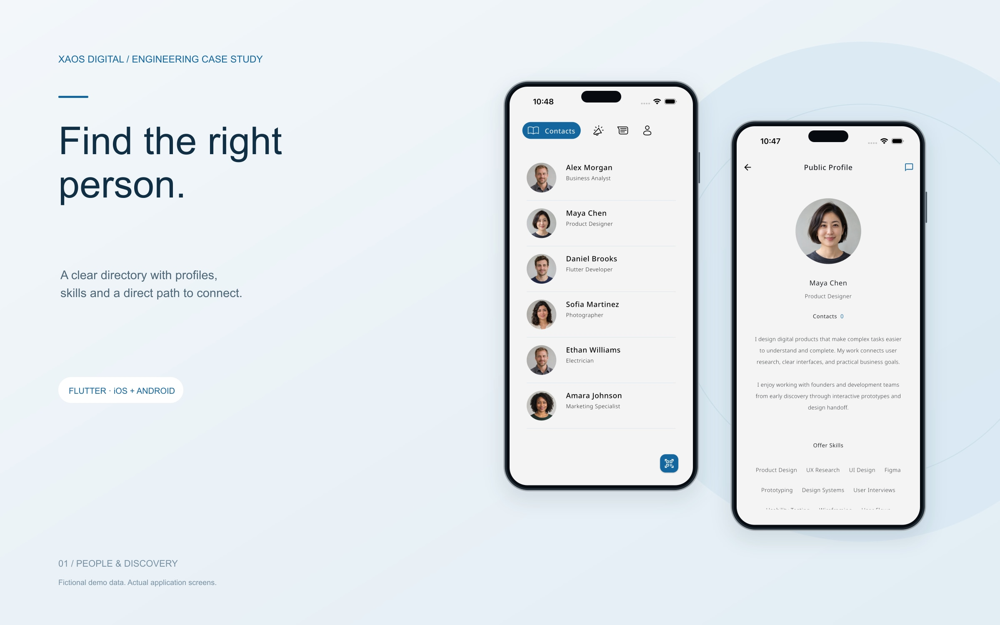
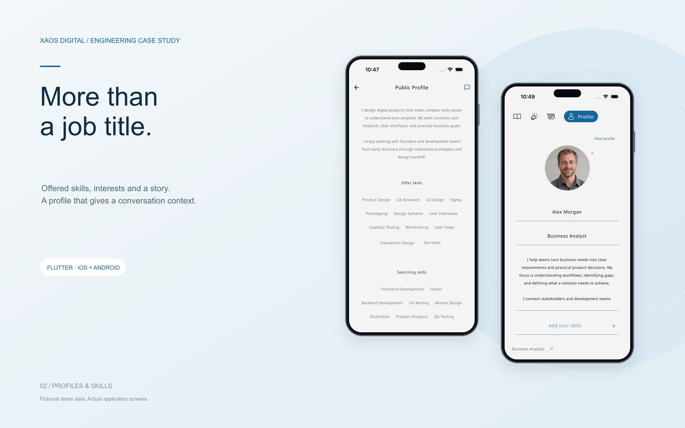
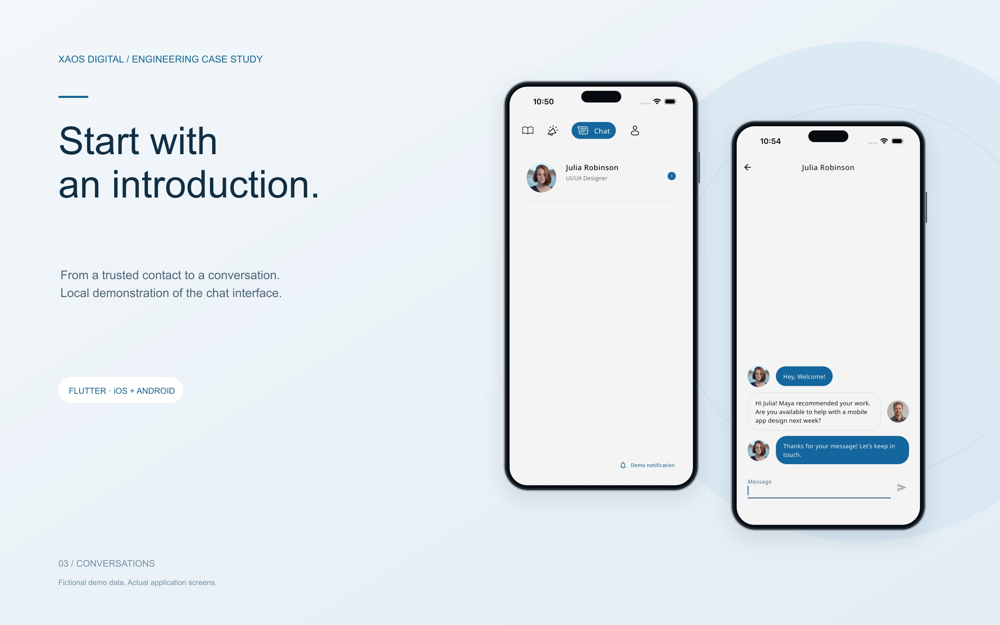
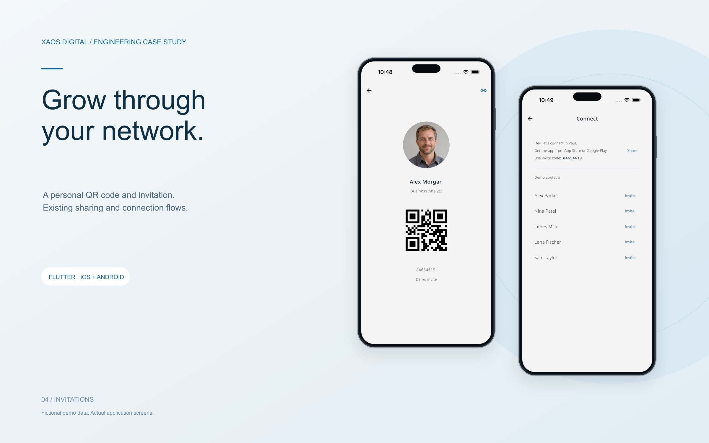
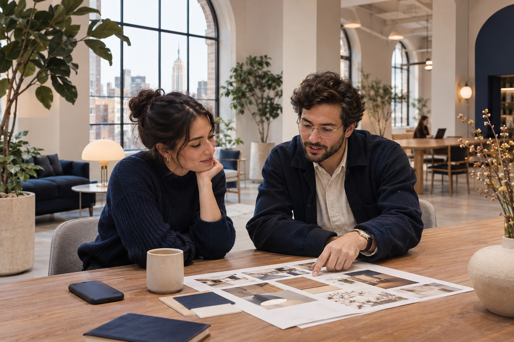

# Portfolio visuals

The eight PNG files in raw/ are full-resolution (1206 × 2622) captures from the running Flutter demo in iOS Simulator. Sample identities are fictional. The conversation is a locally simulated demonstration.

The cover and four landscape compositions place those unchanged application captures inside complete device frames. Illustrations show fictional situations of professional introduction and collaboration; they are conceptual photography, not evidence of a deployed customer workflow.

## Illustrative scenarios

